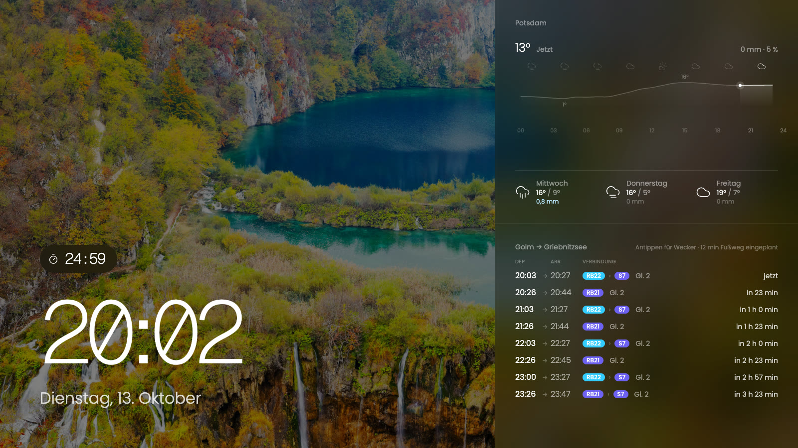

# Dash

Ein Dashboard für ein Touch-Display an der Wand: Uhr, Wetter, die nächsten Züge und ein paar
kleine Apps, vor dem Bing-Bild des Tages.



## Was es zeigt

- **Uhr und Datum** vor dem aktuellen [Bing-Bild des Tages](https://www.bing.com).
- **Wetter für Potsdam**: Temperatur und Niederschlag des Tages als Verlauf, dazu die nächsten
  drei Tage. Daten von [Open-Meteo](https://open-meteo.com).
- **Verbindungen Golm → Griebnitzsee** mit Verspätungen und Ausfällen, über
  [v6.vbb.transport.rest](https://v6.vbb.transport.rest). Ein Tap auf eine Verbindung stellt
  einen Wecker, der 12 Minuten vor Abfahrt klingelt.
- **App-Drawer**: Tap oder Wisch nach oben auf dem Bild. Bisher gibt es einen Timer; laufende
  Timer erscheinen über der Uhr.
- **Nachtmodus** von 22:00 bis 05:55: rote Schrift auf Schwarz, ohne Hintergrundbild. Lässt sich unten im
  App-Drawer von Hand umschalten und hält dann bis zum nächsten Wechsel des Zeitplans.

Wecker und Timer werden im Browser gespeichert und überstehen ein Neuladen.

## Starten

```sh
bun install
bun run dev
```

Für den Betrieb `bun run build` und das Ergebnis mit einem passenden
[SvelteKit-Adapter](https://svelte.dev/docs/kit/adapters) ausliefern. Die Seite braucht ihren
Server: Bild, Wetter und Verbindungen werden dort abgerufen und kurz zwischengespeichert.

### Als Kiosk unter Windows

Edge startet so direkt im Vollbild und darf den Weckton ohne vorherigen Tap abspielen:

```
msedge.exe --kiosk http://HOST:PORT --edge-kiosk-type=fullscreen --autoplay-policy=no-user-gesture-required --user-data-dir=C:\dash-kiosk --no-first-run
```

Ohne diese Parameter schaltet der erste Tap auf die Seite in den Vollbildmodus und gibt den Ton
frei. `?disable_fullscreen` an der Adresse unterdrückt den Vollbildwechsel, etwa beim Entwickeln.

## Eigene Apps

Eine App ist ein Ordner unter `src/lib/apps/`, der ein `DashApp` exportiert (siehe
`src/lib/apps/types.ts`), und eine Zeile in `src/lib/apps/index.ts`. Sie bringt eine Ansicht für
den Drawer mit, optional eine Live-Anzeige über der Uhr und Hintergrundlogik. Mit dem Rest der
Seite spricht sie nur über den `AppHost`: zurück zum Homescreen und Alarm auslösen.
`src/lib/apps/timer/` dient als Vorlage.

Ort, Strecke und Vorlaufzeit des Weckers stehen als Konstanten in `src/routes/+page.server.ts`
und `src/routes/+page.svelte`.

## Hinweise

- **KI-generiert:** Der Code in diesem Repository wurde größtenteils von einem KI-Assistenten
  (Claude) nach Vorgaben geschrieben und nur stichprobenartig von einem Menschen geprüft. Er kann
  Fehler enthalten; Nutzung auf eigene Verantwortung.
- **Inoffizielle Datenquellen:** Die Schnittstellen für Bing-Bild und Verbindungen sind nicht
  offiziell und können sich ändern oder ausfallen. Das Hintergrundbild gehört den jeweiligen
  Rechteinhabern.
- **Weckton:** `static/alarm.mp3` ist ein Platzhalter aus einem YouTube-Video und nicht Teil
  einer Lizenz dieses Projekts. Vor einer Veröffentlichung ersetzen.
